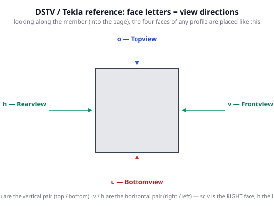
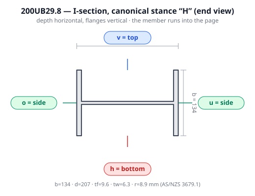
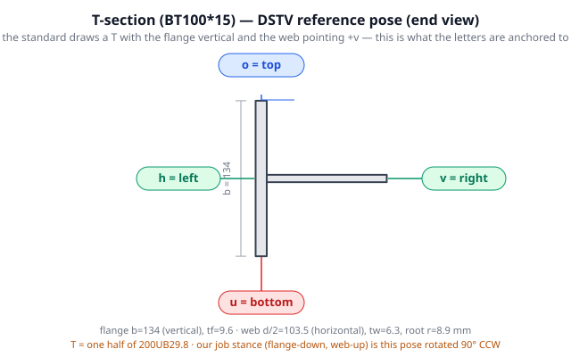
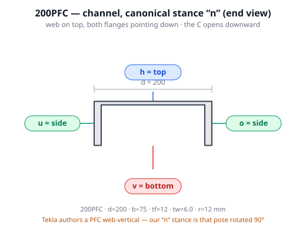
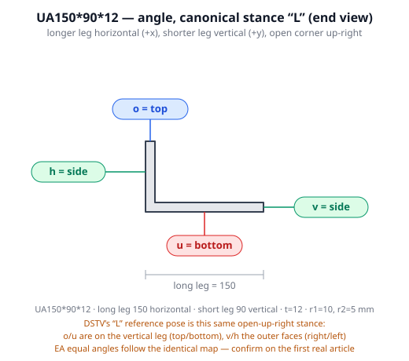
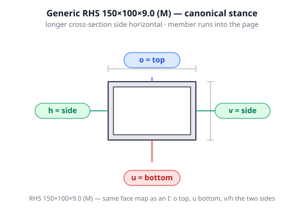

# Canonical orientation & cut-side rules

Every part we nest runs on the same **CNC steel tube laser**, cut and clamped from a set of
canonical stock poses. This document is the single source of truth for:

1. which way each stock section stands on the machine (**canonical stance**),
2. what each DSTV face (`v` / `o` / `u` / `h`) physically is once the stock is in that stance
   (**face → machine role**), and
3. which faces we prefer to cut, and when a bottom cut is allowed (**cut-side priority**).

The rules exist because orientation has repeatedly been the source of "which way is up" bugs.
Treat them as normative for nesting, viewer seating, and STEP/NC output. Code that implements
them lives in `src/lib/sections/stock.ts` (stances) and `src/lib/sections/canonical.ts`
(roles + guards).

## 1. Two frames

- **Section frame** — the 2-D cross-section the profile is drawn in, as built by
  `stockOutlineForCode` / `partSectionForCode`. By our convention:
  **+x = right, +y = up**, origin at the section's bounding-box centre. The member length
  runs along the third axis (named X in the NC→solid rebuild).
- **Machine frame** — the laser table. The cutting head works from above and from the upper
  sides; it cannot reach the underside without risking the head. So:
  **+y = top (head cuts down from here), −y = bottom (avoid), ±x = side (head cuts from the side).**

Seating a stock beam in the canonical stance is nothing more than choosing the rotation about
the member axis that lands the section's **+y on machine-top**.

## 2. Canonical stock stances

| Family (DSTV type) | Canonical stance | Sketch | Why |
|---|---|---|---|
| UB / UC / TFB (`I`) | **H** — web vertical, flanges horizontal | `H` | Stable, flat top and bottom flange; the natural I stance. |
| PFC / TFC (`U`, `C`) | **n** — web horizontal on top, both flanges pointing straight down | `n` | Web face upward (easy to stamp/cut); sits on the two flange tips. |
| RHS / SHS (`M`) | **long side horizontal** — the longer cross-section side runs in x, the shorter in y | `▭` | Lower profile, wider bearing; square sections unaffected. |
| Angle EA / UA (`L`) | **L** — longer leg horizontal (+x), shorter leg vertical (+y), open corner up-right | `L` | Matches the machine's reference for `o`/`u` (vertical leg). |
| T (`T`) | **flange down, web up** | `⊥` | Flat flange is the bed; web stands up (same as a half-UB). |
| CHS (`RO`/`RU`) | round — orientation is irrelevant to a rolled tube | `○` | — |

These are the poses the viewer draws and the poses the STEP output is built in. The
`stock.ts` builders are the implementation; changing a stance means changing the builder and
the tests in `stock.test.ts`.

> **DSTV vs machine stance.** DSTV/Tekla have their *own* reference orientation for each
> profile type (e.g. Tekla exports a channel with the web **vertical**, per the DSTV profile
> diagram). Our canonical stance for a PFC (`n`) is therefore a **90° rotation** of Tekla's
> export stance. When we ingest a real part STEP we seat it into our stance with the
> rotation/mirror search in `reconstructFromNc.orientToReference` — it does not need to match
> Tekla's.

## 3. DSTV faces and their machine role

DSTV face letters (the first token of every `BO` / `AK` / `IK` / `SI` line):

| Letter | German | Meaning |
|---|---|---|
| `v` | Vorderseite | front / web |
| `o` | Oben | top |
| `u` | Unten | bottom |
| `h` | Hinten | behind / rear |

**The letters are the four view directions of the profile, not just labels.** In the DSTV/Tekla
reference (Klietsch poster; DSTV standard), looking along the member — beam into the page — the
faces are placed: `o` = **Topview** (view direction ↓), `u` = **Bottomview** (↑), `v` =
**Frontview** (←, i.e. viewed from the right → the **right** face), `h` = **Rearview** (→, viewed
from the left → the **left** face). **So `v` is the *right* side and `h` the *left*** — see
`figures/faces-reference-views.svg`.

The letters are anchored to each profile's **reference pose** (how the standard draws it), which
is **not always our canonical stance**:

| DSTV type | Reference pose (as the standard draws it) | Faces in that pose |
|---|---|---|
| `I` | web vertical, flanges horizontal | `o` top flange, `u` bottom flange, `h`/`v` the two web faces (left/right) |
| `U` / `C` | **web vertical, C opening right** | `o`/`u` top/bottom flange faces, `h` outer web face (left), `v` the open side (right) |
| `L` | legs vertical + horizontal, open up-right | `o`/`u` the vertical-leg ends, `h`/`v` the outer faces |
| `M` | rect tube (longer side per exporter) | `o`/`u` top/bottom, `h`/`v` left/right |
| `T` | **flange vertical, web horizontal (pointing +v)** | `o`/`u` the flange ends, `h` the flange's outer broad face (left), `v` the web end (right) |
| `RO` / `RU` | round — the letters are arbitrary | around the circumference |

Source: Klietsch *DSTV NC Data* poster (profile types, axes, views) —
<https://klietsch.com/?action=240827&lang=en&m=page>.

**These are relative to the part's own modelled orientation, not to the machine.** Which
physical surface each letter addresses is **profile-type dependent** — that is the whole
problem. The strongest public evidence for the reference orientation is Tekla's *default hard
stamp face* per profile (Tekla Structures → NC files):

| DSTV profile | Tekla default stamp face |
|---|---|
| `I` | bottom flange (`u`) |
| `U`, `C` | back side of web (`h`) |
| `L` | back (`h`) or bottom (`u`) |
| `M` (rect tube) | bottom flange (`u`) |
| `T` | back side of web (`h`) |
| `RO`/`RU` (round) | `v` (tube) / `u` (bar) |

The machine role of a face in **our** canonical stance is then the direction its outward
normal points: **+y = top, −y = bottom, ±x = side**. Working that through for the two
non-ambiguous families:

| Family | `o` | `u` | `v` | `h` |
|---|---|---|---|---|
| `I` (H stance) | **top** | **bottom** | **side** | **side** |
| `U`/`C` (n stance) | **side** | **side** | **bottom** | **top** |
| `M` (tube, long-horizontal) | top | bottom | side | side |
| `T` (flange-down) | side | bottom | side | side |
| `L` (L stance) | **top** † | **bottom** † | **side** | **side** |

† For an angle the roles depend on which leg is vertical once seated; Tekla's own rule is
"`o`/`u` are on the leg that is vertical on the machine". In our L stance the vertical leg
(top end → `o`) stands on +y, so `o`/`u` are top/bottom and `v`/`h` the two sides — the value
pinned in `canonical.ts` and drawn in `figures/faces-angle.svg`. Confirm on the first article.

> **T open issue.** Rotating the T's *reference pose* (flange vertical, web pointing `+v`) onto
> our flange-down / web-up stance the same way as `I` / `U` gives `h` = **bottom** (the flange's
> outer broad face) and `v` = **top** (the web end), with `o`/`u` as the two sides — **not** the
> `T` row above. `canonical.ts` currently lists `{ o: side, u: bottom, v: side, h: side }`. One of
> the two is wrong; confirm against the first real T article (the runtime material-sample in
> `ncFaces.ts` still places the *geometry* correctly either way; only cut-priority is affected).

**For a channel loaded as `n` this gives a useful result:** the flange broad faces are the
sides (`o`/`u`) — exactly where we *want* to cut (see §4) — and the web's outer face is the
top (`h`, matching Tekla's default stamp face). Web holes are top/bottom; flange holes are
side holes.

> The NC→solid rebuild already reconciles this dynamically instead of trusting a hard table:
> `resolveNcFaceFrame` (`src/lib/parsers/ncFaces.ts`) matches each `v`/`h` or `o`/`u` contour's
> across-extent to the section's two dimensions, and `faceNormal` yields the outward normal the
> viewer projects with. The table above is the *documented expectation*; the extent match is the
> *runtime* truth. They must agree — the m41/m31/m87 overlap tests guard it.

### Figures — which physical side each letter lands on

Real sections, end-on (the member runs into the page), with each DSTV face and the machine role
it becomes in the canonical stance (`figures/`):













## 4. Cut-side priority

Because the head is most controllable cutting the **sides** and least safe cutting the
**bottom**:

1. **Side** cuts first (most controllable, best accuracy).
2. **Top** cuts next.
3. **Bottom** cuts only when the removed piece is light enough not to endanger the head.

In code: `CUT_ROLE_PRIORITY = { side: 0, top: 1, bottom: 2 }` and `cutPriority(family, face)`.

### Bottom-cut mass guard

A bottom cut ejects a slug that can fall onto / into the head. The guard is a **mass** rule,
not a face rule: a bottom cut is permitted iff the material it removes weighs **< 10 g**.
(`BOTTOM_CUT_MAX_GRAMS = 10`.) Under 10 g is "easily ok".

Removed mass for a hole of diameter `d` through wall thickness `t`:

```
mass_g = π · (d/2)² · t · ρ      with ρ = 7.85e-3 g/mm³
```

For calibration: Ø14 through a 9.6 mm flange ≈ 11.6 g (guard: **not** OK on the bottom);
Ø10 through 9.6 mm ≈ 5.9 g (OK). `bottomCutAllowed(massGrams)` implements the check;
`holeRemovedMassGrams(diameter, thickness)` computes it.

> The threshold is a starting policy, to be tuned with the operator. It is intentionally a
> parameter (`maxGrams`) so a job can override it.

## 5. Cut order & collisions

Unchanged and re-stated for completeness (see `AGENTS.md`):

- **Shortest piece first** (front → back).
- Keep the stock **whole and clamped**; split the lengthwise web cut **locally**, only as far
  as the next piece needs, so one piece releases at a time.
- **Never cut the same line twice** — keep the **cut-collision / min-separation guard** that
  flags left/right (or adjacent) cuts on the same or a near line.

## 6. Code map

| Concern | Where |
|---|---|
| Stock stances (the drawn cross-section) | `src/lib/sections/stock.ts` — `channel` (n), `hollowRect`/`rectangle` (long-horizontal), `ubOutlineFromDims` (H), `angleL` (L), `teeOutline` (flange-down) |
| Face → machine role, cut priority, mass guard | `src/lib/sections/canonical.ts` (pure, unit-tested) |
| Runtime face frame / normals | `src/lib/parsers/ncFaces.ts` |
| Seating a real part into the stance | `src/lib/step/reconstructFromNc.ts` (`orientToReference`) |

## 7. Sources

- Tekla — NC files (default hard-stamp face per profile): https://support.tekla.com/doc/tekla-structures/2026/int_create_nc_files
- Tekla — DSTV file description (faces `v`/`o`/`u`/`h`): https://support.tekla.com/doc/tekla-structures/2026/int_nc_dstv_file_description
- NC1-Viewer — block codes & profile types: https://www.nc1-viewer.com/guides/dstv-block-codes
- The Fabricator — "File export fundamentals in structural steel fabrication" (plain-language DSTV faces + machine-clearance advice): https://www.thefabricator.com/thefabricator/article/cadcamsoftware/file-export-fundamentals-in-structural-steel-fabrication
- SDS2 — DSTV options ("`o` and `u` are on the leg that is vertical on the CNC machine"): https://techsupport.sds2.com/sds2_2023/Topics/cnc_dstv.htm
- Klietsch — DSTV NC profile/axis overview: https://klietsch.com/?action=240827&lang=en&m=page
- See also `docs/nc1-dstv-format.md` and `docs/wisecam-debugging.md`.
